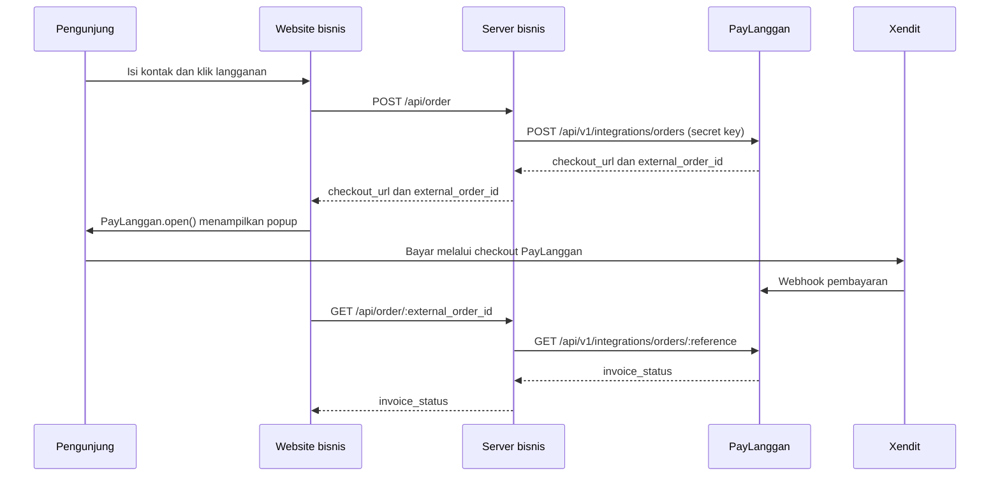

# Memasang drop-in PayLanggan di website bisnis

Drop-in menampilkan halaman pembayaran PayLanggan sebagai popup di website bisnis. Pengunjung tetap berada di halaman bisnis saat mengisi data dan membuka checkout. Form kartu di dalam checkout memakai Xendit Components. Jika autentikasi kartu memerlukan halaman penuh, popup menyediakan tautan **Buka halaman penuh**.

Ada dua cara memasang widget. **Skrip siap pakai** hanya memerlukan satu tag skrip dan tombol di website bisnis; PayLanggan menampilkan formulir kontak lalu membuat pesanan. **API server** memakai secret key di backend bisnis agar bisnis dapat mengaitkan pesanan dengan akun pengguna dan memeriksa status secara aman. Keduanya membuka checkout PayLanggan dalam popup, dengan komponen kartu Xendit. Harga final selalu dibaca dari plan di katalog PayLanggan.

Contoh API server yang bisa dijalankan ada di [website Kelana Workspace](../examples/dropin-demo/index.html) dan [server demonya](../examples/dropin-demo/server.mjs). Contoh skrip siap pakai ada di [halaman sederhana](../examples/dropin-simple/index.html).

## Cara A — skrip siap pakai

1. Di dashboard PayLanggan, buka **Pengaturan → Integrasi Website → Via skrip drop-in**. Buat satu **ID integrasi bisnis**. Anda tidak perlu mengisi nama atau URL website. Semua plan aktif milik bisnis yang mendukung checkout kartu tersedia otomatis.
2. Salin **Skrip header** dan pasang sekali di website bisnis. Pilih plan dari daftar untuk mendapatkan **Kode tombol** masing-masing plan. Beberapa tombol dapat memakai skrip header yang sama. Contoh bentuknya:

```html
<script src="https://checkout.paylanggan.id/paylanggan.js"
        data-pl-site="pl_site_ID_PUBLIK"
        data-pl-api-url="https://api.paylanggan.id"></script>
<button data-pl-checkout data-pl-plan="pl_plan_0123456789abcdef01234567">Langganan Profesional Bulanan</button>
```

Jika bisnis membuat plan baru, buka halaman integrasi untuk memilih plan dan menyalin kode tombol barunya. Setiap plan memiliki ID publik tetap berbentuk `pl_plan_...`, meski nama atau harganya berubah. ID integrasi bisnis `pl_site_...` dan skrip header lama tetap berlaku. Checkout menolak plan milik bisnis lain, plan yang tidak mendukung pembayaran kartu, serta ID integrasi yang telah dicabut.

Tombol lama yang masih memakai ID plan angka tetap diterima selama masa transisi. Untuk tombol baru, gunakan kode berisi `pl_plan_...` dari dashboard.

3. Ketika tombol diklik, widget meminta nama, email, dan nomor ponsel. PayLanggan membuat pesanan dari plan bisnis lalu membuka popup checkout. Kartu dimasukkan di komponen Xendit dalam checkout PayLanggan. Browser menerima event `paylanggan:paid` untuk memperbarui tampilan.

```js
document.addEventListener('paylanggan:paid', (event) => {
  console.log('Referensi pesanan:', event.detail.externalOrderId)
  // Hanya ubah tampilan. Jangan aktifkan layanan berdasarkan event browser.
})
```

Widget juga menyediakan `PayLanggan.openEmbed({ siteId, planId, apiUrl, onPaid, onClose })` jika bisnis ingin memakai tombol miliknya sendiri. `planId` di sini berisi ID publik `pl_plan_...`; `siteId` adalah ID integrasi publik `pl_site_...`, **bukan kunci rahasia**. Tidak ada pembatasan URL website pada mode ini. Artinya ID integrasi dapat disalin dan dipakai dari domain lain. Backend tetap memastikan plan milik bisnis yang sama, status bisnis aktif, dan menerapkan pembatasan permintaan. Untuk verifikasi pesanan yang aman dan mengaktifkan layanan, gunakan cara B.

**Batas penting:** mode skrip siap pakai belum menyediakan cara tepercaya bagi backend bisnis untuk menerima status pembayaran otomatis. Event browser dan alamat checkout publik tidak boleh digunakan untuk memberi akses berbayar atau mengirim barang. Jika website harus mengaktifkan layanan setelah pembayaran, gunakan cara B dan periksa `invoice_status=paid` melalui API server, atau tambahkan integrasi status server sebelum dipakai untuk fulfillment.

Untuk mencoba halaman sederhana tanpa `server.mjs`, gunakan demo HTML statis di [folder ini](../examples/dropin-simple/README.md). Isi URL widget, ID integrasi, URL API, dan ID plan langsung di `index.html`. Jalankan server file statis bawaan Python dari akar proyek:

```powershell
python -m http.server 4176 --directory .\examples\dropin-simple
```

Buka `http://localhost:4176`. Python hanya menyajikan file HTML statis; halaman checkout dan pembuatan pesanan tetap ditangani oleh PayLanggan. Untuk kartu Xendit Components pada Test Mode, isi URL widget dengan tunnel HTTPS frontend PayLanggan yang aktif dan `data-pl-api-url` dengan tunnel HTTPS backend yang dapat dijangkau browser. Setelah mengganti tunnel, perbarui URL tersebut dan buat pesanan baru. Demo ini tidak memakai secret key.

## Cara B — API server bisnis

## Gambaran alur



**Status `paid` dari API PayLanggan adalah dasar untuk mengaktifkan layanan di website bisnis.** Callback `onPaid` dari browser hanya memberi tahu bahwa tampilan perlu diperbarui. Jika popup ditutup, pembayaran belum tentu gagal; periksa status pesanan yang sama.

## 1. Persiapan di PayLanggan

1. Jalankan migrasi backend terbaru, termasuk `2026-09-29-31_merchant_dropin.sql` dan `2026-10-01-32_merchant_embed_sites.sql`.
2. Pastikan langganan bisnis kepada PayLanggan masih `active`.
3. Buat produk berstatus aktif dan plan di katalog bisnis. Buka **Dashboard → Katalog → Plan**, lalu gunakan **Salin ID** pada plan yang dijual. ID juga tertulis kecil di bawah nama plan. Request pembelian memakai **ID plan**, bukan ID layanan atau produk. API integrasi saat ini menerima plan `monthly` atau `yearly`, tanpa trial, dengan harga kartu berupa rupiah bulat antara Rp5.000 dan Rp200.000.000.
4. Login sebagai **admin bisnis**. Di dashboard buka **Integrasi Website → Buat kunci**, isi nama website, lalu salin secret key yang muncul. Halaman ini juga menampilkan daftar kunci dan menyediakan tindakan **Cabut kunci**. Jika menggunakan API langsung, request-nya:

```http
POST /api/v1/integrations/keys
Authorization: Bearer <JWT_ADMIN_BISNIS>
Content-Type: application/json

{"name":"Website Kelana Workspace"}
```

Simpan nilai `data.secret_key` dari respons pada **server bisnis**. Kunci itu hanya ditampilkan sekali. Endpoint `GET /api/v1/integrations/keys` menampilkan daftar kunci, dan `DELETE /api/v1/integrations/keys/:id` mencabutnya. Ketiga endpoint pengelolaan kunci memerlukan JWT admin bisnis.

Jangan menaruh secret key di HTML, JavaScript browser, URL, atau repository. Widget `paylanggan.js` sendiri tidak memerlukan secret key.

## 2. Hubungkan server bisnis ke PayLanggan

Website bisnis perlu endpoint miliknya sendiri untuk membuat pesanan. Server bisnis mengirim permintaan berikut menggunakan secret key:

```http
POST /api/v1/integrations/orders
Authorization: Bearer pl_sk_<RAHASIA>
Content-Type: application/json

{
  "external_order_id": "pesanan-2026-001",
  "plan_id": 10,
  "customer": {
    "name": "Dira Pratama",
    "email": "dira@kelana.id",
    "mobile": "+6281234567890"
  }
}
```

Respons sukses berbentuk `{"success":true,"data":{...}}`. Objek `data` memuat `external_order_id`, `invoice_id`, `invoice_status`, dan `checkout_url`. Kirim `checkout_url` dan `external_order_id` ke browser, tanpa secret key. Di server, ambil `plan_id` dari katalog atau konfigurasi yang Anda kendalikan; jangan percaya harga atau ID paket yang dikirim bebas dari browser.

API server ini tetap memakai `plan_id` numerik karena dipanggil oleh server bisnis dengan secret key. ID publik `pl_plan_...` dipakai oleh skrip siap pakai yang berjalan di browser.

`external_order_id` adalah referensi pesanan di sistem bisnis. Simpan dan gunakan **referensi yang sama saat mengulang request** agar tidak membuat tagihan ganda. Mengirim referensi yang sudah dipakai untuk paket atau email lain akan ditolak. Jika sesi checkout lama masih aktif, API dapat mengembalikan `409`; periksa status pesanan sebelum mencoba lagi.

Untuk membaca status:

```http
GET /api/v1/integrations/orders/pesanan-2026-001
Authorization: Bearer pl_sk_<RAHASIA>
```

Objek `data.invoice_status` adalah status dari PayLanggan. Endpoint status ini tidak mengirim ulang `checkout_url`. Karena itu, server bisnis perlu menyimpan tautan checkout selama pesanan masih perlu dibayar. Simpan relasi pesanan bisnis, `external_order_id`, ID pelanggan lokal, dan status terakhir di database Anda.

Lihat implementasi server minimal yang bekerja di [server.mjs](../examples/dropin-demo/server.mjs): `POST /api/order` meneruskan permintaan pembuatan pesanan, dan `GET /api/order/:external_order_id` memeriksa statusnya. Di aplikasi sungguhan, endpoint ini juga perlu memeriksa identitas pengguna serta kepemilikan pesanan sebelum mengembalikan data.

## 3. Pasang skrip di halaman bisnis

Muat skrip dari **origin frontend PayLanggan yang sama dengan `checkout_url`**. Contoh:

```html
<script src="https://checkout.paylanggan.id/paylanggan.js"></script>
<form id="langganan">
  <input name="name" placeholder="Nama lengkap" required>
  <input name="email" type="email" placeholder="Email" required>
  <input name="mobile" type="tel" placeholder="+6281234567890" required>
  <button type="submit">Langganan sekarang</button>
</form>
<script>
  document.getElementById('langganan').addEventListener('submit', async (event) => {
    event.preventDefault()
    const customer = Object.fromEntries(new FormData(event.currentTarget))
    // Endpoint ini milik server bisnis, bukan API PayLanggan langsung dari browser.
    const response = await fetch('/api/order', {
      method: 'POST',
      headers: { 'Content-Type': 'application/json' },
      body: JSON.stringify(customer)
    })
    const order = await response.json()
    if (!response.ok) throw new Error(order.error || 'Pesanan belum dapat dibuat')

    PayLanggan.open({
      checkoutUrl: order.checkout_url,
      onPaid: async () => {
        const result = await fetch('/api/order/' + encodeURIComponent(order.external_order_id))
        const status = await result.json()
        if (status.invoice_status === 'paid') {
          // Tampilkan hasil. Server bisnis juga mencatat dan mengaktifkan akses.
        }
      },
      onClose: () => {
        // Simpan pesanan; pengguna mungkin masih perlu melanjutkan pembayaran.
      }
    })
  })
</script>
```

Contoh di atas menunjukkan titik pemasangan widget. Implementasi yang menangani formulir, status, reload halaman, dan percobaan melanjutkan checkout ada di [index.html](../examples/dropin-demo/index.html). Widget memvalidasi bahwa `checkout_url` berasal dari origin skrip dan berbentuk `/checkout/:token`; URL dari domain lain akan ditolak. API widget yang tersedia adalah `PayLanggan.open({ checkoutUrl, onPaid, onClose })` dan `PayLanggan.close()`.

Jangan mengaktifkan paket hanya karena browser menampilkan “berhasil”. Pembayaran dipastikan lewat webhook Xendit ke backend PayLanggan, kemudian server bisnis membaca status `paid`. Untuk sistem yang harus tetap tersinkron ketika pengunjung menutup tab, jalankan pemeriksaan status berkala di server bisnis. Webhook khusus dari PayLanggan ke server bisnis belum tersedia.

## 4. Jalankan website demo di komputer sendiri

Buka terminal terpisah untuk tiap proses:

**Terminal 1 — backend**, dari folder `Backend`:

```powershell
go run ./cmd/api
```

**Terminal 2 — frontend PayLanggan**, dari folder `Frontend`:

```powershell
npm install
npm run dev
```

**Terminal 3 — website bisnis**, dari akar proyek:

```powershell
$env:PAYLANGGAN_API_URL = 'http://localhost:8080'
$env:PAYLANGGAN_CHECKOUT_ORIGIN = 'http://localhost:5173'
$env:PAYLANGGAN_SECRET_KEY = '<secret-key-bisnis>'
$env:PAYLANGGAN_PLAN_ID = '<id-paket-kelana>'
node .\examples\dropin-demo\server.mjs
```

Buka **http://localhost:4174**. Isi nama, email, dan nomor ponsel, lalu klik **Lanjutkan ke pembayaran**. Popup akan menampilkan checkout PayLanggan. Website demo menyimpan referensi pesanan dan URL checkout pada `sessionStorage` tab itu agar refresh halaman tidak membuat pesanan baru. Tombol **Periksa status** membaca status dari server; tombol **Buat pesanan baru** digunakan jika memang ingin memulai transaksi baru. Data kontak dan secret key tidak disimpan di `sessionStorage`.

Nilai `PAYLANGGAN_PLAN_ID` harus menunjuk paket aktif milik bisnis yang membuat secret key. Jika paket itu berbeda dari **Profesional Bulanan** Rp100.000/bulan, sesuaikan nama dan harga yang ditampilkan di halaman demo.

## 5. Uji pembayaran Xendit Test Mode

Untuk Xendit Components, checkout PayLanggan perlu origin frontend HTTPS yang dapat diakses publik. Jika memakai Cloudflare Quick Tunnel, jalankan tunnel menuju frontend port 5173, lalu samakan nilai berikut dengan **origin** tunnel itu, tanpa path atau garis miring di akhir:

```text
Backend/.env: APP_PUBLIC_URL=https://<tunnel-frontend>.trycloudflare.com
Backend/.env: XENDIT_RETURN_BASE_URL=https://<tunnel-frontend>.trycloudflare.com
Terminal demo: PAYLANGGAN_CHECKOUT_ORIGIN=https://<tunnel-frontend>.trycloudflare.com
```

Atur `Frontend` agar `VITE_API_URL` menunjuk API backend yang dapat dijangkau browser, misalnya tunnel backend port 8080. Webhook Xendit **Payment Session** juga harus menuju URL backend yang sedang aktif: `https://<tunnel-backend>.trycloudflare.com/api/v1/webhooks/xendit/payment-sessions`. Gunakan kredensial **Test Mode** dan `XENDIT_MOCK=false` di backend. Restart backend, frontend, dan demo setelah perubahan environment, lalu buat pesanan baru. Quick Tunnel dapat berganti alamat saat dijalankan ulang; perbarui origin, URL webhook, dan konfigurasi lain yang memakai alamat lama.

Website bisnis boleh tetap di `http://localhost:4174` selama pengujian lokal. Popup berasal dari frontend PayLanggan HTTPS. Jika alur autentikasi kartu 3DS tidak berjalan di iframe, gunakan **Buka halaman penuh** pada popup. Beberapa kartu simulasi Xendit memiliki perilaku autentikasi yang berbeda; transaksi yang tampak berhasil di Xendit masih perlu diverifikasi lewat status invoice PayLanggan.

## Masalah yang sering muncul

| Gejala | Yang perlu diperiksa |
| --- | --- |
| `Invalid PayLanggan checkout URL` | Origin `PAYLANGGAN_CHECKOUT_ORIGIN` harus sama persis dengan origin `checkout_url` dan URL skrip. |
| `401` pada API pesanan | Secret key salah, dicabut, atau memakai JWT sebagai pengganti secret key. |
| `403` pada API pesanan | Langganan bisnis ke PayLanggan tidak aktif atau akses bisnis tidak memenuhi syarat. |
| `400` atau `404` pada API pesanan | Periksa ID paket, status paket, data pelanggan, dan kepemilikan paket oleh bisnis. |
| `409` pada API pesanan | Referensi pesanan pernah dipakai atau checkout sebelumnya masih aktif; baca status referensi itu. |
| Popup ditutup tetapi belum lunas | Buka kembali checkout untuk pesanan yang sama dan periksa statusnya. |
| Xendit sudah berhasil tetapi website masih menunggu | Periksa URL webhook, riwayat pengiriman webhook Xendit, dan status invoice di PayLanggan. |
| Muncul error `Empty TermURL for the CRes POST` | Ini muncul pada simulasi autentikasi 3DS tertentu. Coba alur halaman penuh dan kartu simulasi lain; jangan anggap invoice lunas sebelum status API menjadi `paid`. |

## Batas implementasi saat ini

- Checkout popup menggunakan iframe; autentikasi bank/3DS tertentu dapat memerlukan halaman penuh.
- API integrasi hanya mendukung paket dasar tanpa trial, kupon, atau add-on pada pesanan awal.
- Belum ada webhook PayLanggan ke server bisnis. Demo memeriksa status dari browser; integrasi produksi sebaiknya menambah rekonsiliasi di server bisnis.
- Drop-in tidak mengubah tujuan dana. Untuk menerima pembayaran atas nama banyak bisnis, rancangan settlement/sub-account perlu diselesaikan tersendiri sebelum penggunaan produksi.
